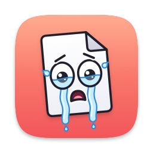
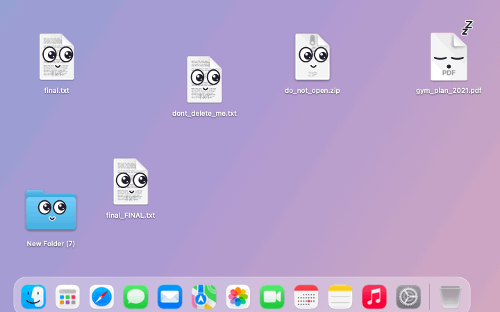
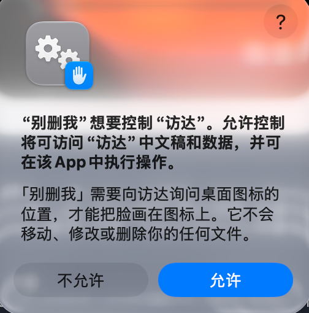
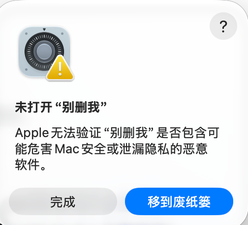
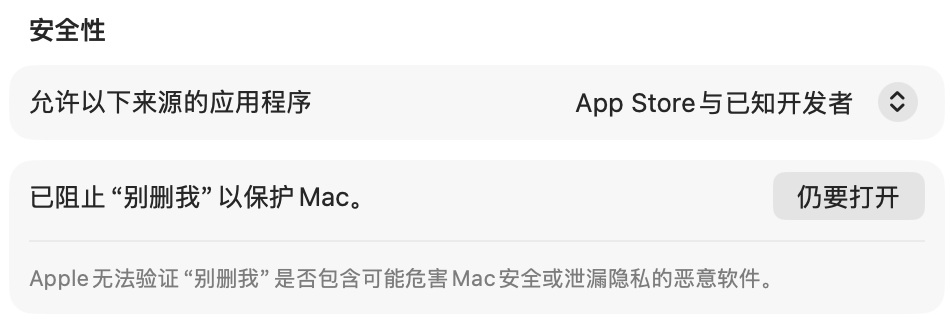

# 别删我

[English](README.md) · **简体中文**

> 给 Mac 桌面上的每个图标安一张脸：它们盯着你的鼠标看，被拖向废纸篓时会吓哭。

<p align="center"></p>
<p align="center"><sub>动图里的脸和反应都是应用自己的代码画的；周围的桌面是仿出来的，不是录屏。</sub></p>

「别删我」只在桌面的**上方画画**：不修改、不移动、不改名，也不删除你的任何文件和图标。下载后打开就能用——不用注册，没有设置项，不联网。

现在是 0.1.0 版，只有 macOS 版。Windows 版在计划中，还没有做。

## 它们会做什么

| 当你…… | 它们…… |
|---|---|
| 移动鼠标 | 眼睛跟着鼠标转，时不时眨一下 |
| 把鼠标停在某个图标上 | 它会脸红，把眼神躲开 |
| 抓起一个图标猛甩 | 它被甩晕——眼睛转成漩涡、头顶冒星星，松手后还要再晕两三秒 |
| 把一个图标拖向废纸篓 | 离得越近越惨：先冒汗，再发抖，最后放声大哭。其它图标也跟着有反应——胆小的捂住眼睛，好奇的从指缝里偷看，胆大的瞪着眼看；这阵恐慌由近到远，像波纹一样传开 |
| 改了主意，把它放回去 | 虚惊一场：汗慢慢收了，围观的也把手放下 |
| 真的把它删了 | 它原来的位置上飘起一个小幽灵。怎么删都一样——拖进废纸篓、按快捷键、用右键菜单都算。一次删好几个，幽灵会一个接一个地冒出来 |
| 把一个文件晾了半年以上 | 它开始打瞌睡。同时睡着的最多占三分之一，鼠标一靠近就惊醒 |
| 十来秒不碰鼠标 | 它们闲得无聊，开始东张西望 |
| 往桌面上放了个新东西 | 大家齐刷刷转头看新来的 |

每个图标的长相都略有不同，性格也各不一样（胆小、好奇、胆大）；同一个图标每次都是同一张脸。

全部的界面只有菜单栏上的一个图标——一双眼睛——点开是两项：**暂停 / 继续** 和 **退出**。程序坞里没有它，也没有设置窗口。支持两块显示器（在内屏加一块外接屏上测试过）；已经在运行时再打开一次，也不会多出第二套脸。

## 下载与首次打开

**系统要求：** Apple Silicon 的 Mac——下载的版本不能在 Intel 的 Mac 上运行。应用声明的最低系统是 macOS 14，但目前只在 macOS 27.0.1 上运行过，其它版本没有测试。

1. 到 [Releases 页面](https://github.com/Yang1703cyn/dont-delete-me/releases/latest)下载 `DontDeleteMe.zip`（约 1.3 MB）。
2. 解压，把 `DontDeleteMe.app` 放到你喜欢的位置，放进"应用程序"文件夹就挺好。
3. 打开它。第一次会被系统拦住，办法见下面。
4. 系统会问：是否允许「别删我」控制「访达」。点 **允许**。（[为什么要问](#授权与隐私)）

   

5. 桌面图标长出了脸，菜单栏上多了一双眼睛。

### 系统不让我打开

「别删我」没有做苹果的公证：公证需要付费的开发者账号，而这个项目没有。macOS 自带的检查不放行这样的应用，所以从网上下载的版本，第一次打开时会被拦下来。

下面的步骤在 macOS 27.0.1 上，用从发布页下载的副本实测过。

1. 双击应用。系统提示 **未打开“别删我”**，说 Apple 无法验证它是否包含恶意软件。点 **完成**——不要点“移到废纸篓”。（图标们不会原谅你的。）

   

2. 打开 **系统设置 → 隐私与安全**（较早的 macOS 里叫“隐私与安全性”），往下翻到“安全性”一栏，会看到“已阻止‘别删我’以保护 Mac。”，点旁边的 **仍要打开**。

   

3. 再确认一次，按提示输入开机密码或用触控 ID。这件事只用做一回。接下来就是上面的第 4 步：允许它控制访达。

不想折腾这一步？可以[从源码构建](#从源码构建)——自己编译出来的应用，打开时不会有这个警告。

## 授权与隐私

一句话：**只要一项授权，只读不写，完全不联网。**

### 唯一的一项授权

这项授权是"控制「访达」"。「别删我」要知道桌面图标在哪，办法是去问访达；macOS 把这件事归在"自动化"授权里，所以第一次打开时你会看到一个询问弹窗，上面带着这样一句说明：

> 「别删我」需要向访达询问桌面图标的位置，才能把脸画在图标上。它不会移动、修改或删除你的任何文件。

它向访达问的是：每个桌面图标的位置、名字、种类、修改时间，以及图标大小之类的桌面显示设置。每一次都只是"读"。应用里没有任何一条会移动、改名或删除东西的请求。

如果你选了不允许，应用就什么都不画。之后想改主意，到 **系统设置 → 隐私与安全 → 自动化** 里找到「别删我」，打开它下面“访达”的开关，一秒钟左右脸就会出来，不用重新打开应用。

### 它不要的权限

辅助功能、输入监控、屏幕录制、完全磁盘访问——一个都不要。它用不着，也从不申请。

### 它还会看什么

下面这些都不需要授权，而且都只是读：

- 访达的一项桌面显示设置——是否开了"叠放"。
- 程序坞的设置和正在运行的应用列表——只为了数出程序坞里有几项，好推算废纸篓在哪。
- 屏幕上有哪些窗口、谁在上谁在下、各自的边界——用来判断桌面有没有被挡住、鼠标是不是落在桌面上。不读窗口标题，也不截屏。
- 鼠标的位置，以及鼠标键有没有按着。它是定时看一眼，不拦截、不改动任何输入。

### 它绝不会做的事

- **绝不联网。** 没有任何网络请求：没有统计，没有更新检查。
- **绝不读取任何文件的内容。**
- **绝不留存你的文件名。** 名字只在内存里用一下，和一份随机数混在一起，给每个图标算出一个读不懂的编号；不保存，也不往任何地方输出。
- **绝不碰你的文件和图标。** 脸画在一层透明的窗口上，这层窗口盖在图标上方，鼠标点击会直接穿过去。

### 它自己保存了什么

只有两样小东西，存在它自己的偏好设置里：一份随机数（保证每个图标每次都长同一张脸），以及它学到的废纸篓位置（几个数字）。

以上每一条都可以对着源码核对。和访达打交道的代码全部在 `Sources/IconBridge/` 里。

## 常见问题

**会不会删我的文件？**
不会。它没有能力移动、改名或删除任何东西，它只会画画。删不删始终由你决定——它也拦不住你。这些图标唯一的自卫手段就是哭。

**会不会很耗电？**
它尽量不碍事，但也不是零开销。下面是在一台机器上量的（Apple Silicon，macOS 27.0.1，桌面约 20 个图标，发布版），数字是占一个处理器核心的比例：

| 情形 | 处理器占用 |
|---|---|
| 暂停时 | 约 0.1% |
| 桌面看不见时（被窗口盖满、全屏应用、锁屏、屏幕睡眠） | 和暂停差不多——这时什么都不画 |
| 桌面露着，鼠标基本不动 | 约 4.3%～4.6% |
| 桌面露着，鼠标时动时停 | 约 5%～6% |

内存约 61 MB。另外，访达回答它的询问也要花一点力气：鼠标不动时大约占一个核心的 0.9%，鼠标在动时约 3.4%（19 个图标时量的，图标越多越高）；应用暂停或桌面看不见时几乎为零。这些数字只代表这一台机器、这一种桌面，我们也没有直接测过对电池续航的影响。想让它歇一会儿，在菜单栏里点 **暂停** 就行。

**为什么有的图标在睡觉？**
超过半年没修改过的文件会打瞌睡。同时睡着的最多占全部图标的三分之一——被冷落得最久的先睡——鼠标一靠近，它就醒了。

**为什么一张脸都没有？**
常见的原因：

- 应用暂停了（菜单栏图标是变淡的）。点 **继续**。
- 桌面开了"叠放"。叠放时图标的位置不可靠，所以不显示脸。
- 系统设置里把桌面上的项目隐藏了。脸会跟着图标一起隐藏。
- 你正在某个全屏应用的空间里。那里没有脸。
- 没有允许它控制访达。见[唯一的一项授权](#唯一的一项授权)。

**脸把图标挡住了一部分。**
是的，会挡住一点。见[已知限制](#已知限制)。

**怎么让它停下来，或者卸载？**
点菜单栏图标里的 **退出**，脸就都没了。卸载：先退出，再把应用拖进废纸篓。（对，我们也觉得这很讽刺。）如果还想清掉它那一点偏好设置和访达授权记录，可以执行 `defaults delete io.github.yang1703cyn.dont-delete-me` 和 `tccutil reset AppleEvents io.github.yang1703cyn.dont-delete-me`。

**有 Windows 版吗？**
还没有。在计划中，尚未实现。

## 已知限制

- 只在 macOS 27.0.1、Apple Silicon 上测试过。下载的版本只支持 Apple Silicon。
- 没有公证，所以第一次打开要多点几下（见上文）。
- 开着"叠放"、隐藏了桌面项目、或者在全屏应用的空间里时，没有脸。
- 脸的位置固定在图标正中偏上。图标中间如果有重要的内容（比如图片的缩略图），会被眼睛盖住。
- 眼泪会盖住文件名的上半截；Zzz 和幽灵会画到上方相邻的图标上。
- 桌面小组件会盖住脸。
- 一次拖好几个图标时，只有鼠标抓着的那一个是主角。
- 不经废纸篓的"立即删除"没有幽灵。
- 你拖着图标的时候，访达不回答询问；所以拖动途中新出现或消失的图标，要等松手之后才反映出来。
- 废纸篓的位置是估算的：先按程序坞的设置和它在屏幕上的实际范围推算，真的删过一次之后会自动校准。
- 第一次来到一个新的桌面空间时，脸会晚大约半秒才淡入。
- 没有为"减弱动态效果"等辅助功能设置做适配。
- Windows 版：计划中，没有实现。

## 从源码构建

需要 macOS 和 Swift 6 工具链。装了苹果的命令行工具（Command Line Tools）就够，不需要完整的 Xcode；没有任何第三方依赖。

```bash
git clone https://github.com/Yang1703cyn/dont-delete-me.git
cd dont-delete-me

swift build                 # 编译全部
swift run DontDeleteMe      # 不打包，直接运行
scripts/build-app.sh        # 打包 → build/DontDeleteMe.app
open build/DontDeleteMe.app
```

用 `swift run` 运行时，程序没有自己的身份，"控制访达"的授权弹窗会算在你的终端程序头上。想看到真实的样子，请打包后打开 `build/DontDeleteMe.app`。

开发时常用：

```bash
scripts/test.sh             # 跑单元测试
scripts/check.sh            # 编译无警告 + 模块依赖规则 + 测试 + 演示程序
```

开发文档（中文）在 [`docs/`](docs/) 里，建议从 [`docs/开发说明.md`](docs/开发说明.md) 读起。

## 工作原理

- **IconBridge（图标桥）** 向访达询问桌面图标在哪，并持续发现新增、移动、消失的图标。
- **Overlay（叠加层）** 把脸显示在透明的、鼠标点得穿的窗口里——一层紧贴在桌面图标上方，另一层在所有东西之上，专门给正被拖着的那个图标用；桌面看不见的时候就停止绘制。
- **InputSense（交互感知）** 盯着鼠标，判断你在做什么：悬停、拖拽、猛甩、正朝废纸篓去，以及松手之后的结局。
- **Emotion（情绪）** 把这些变成情绪。这里没有"开 / 关"式的状态，只有几个连续变化的数值（惊恐、汗、泪、头晕、脸红、困意……）各自渐入渐出，所以表情之间的过渡是平滑的。
- **Faces（表情绘制）** 每一张脸都是用代码（Core Graphics）画出来的，没有任何图片素材。

五个模块互不相识，由应用入口把它们接成一条流水线。全部用 Swift 和 AppKit 写成。

## 相近的小玩具

如果你也喜欢会回看你的东西：

- [Googly Eyes](https://sindresorhus.com/googly-eyes)（作者 Sindre Sorhus）——macOS 菜单栏里的一双眼睛，跟着你的鼠标转。
- [The Icon Battles](https://store.steampowered.com/app/2135980/)（Yenot Software）——在 Windows 上，桌面图标活过来互相打架。

## 许可

[MIT](LICENSE) © 2026 Don't Delete Me contributors
